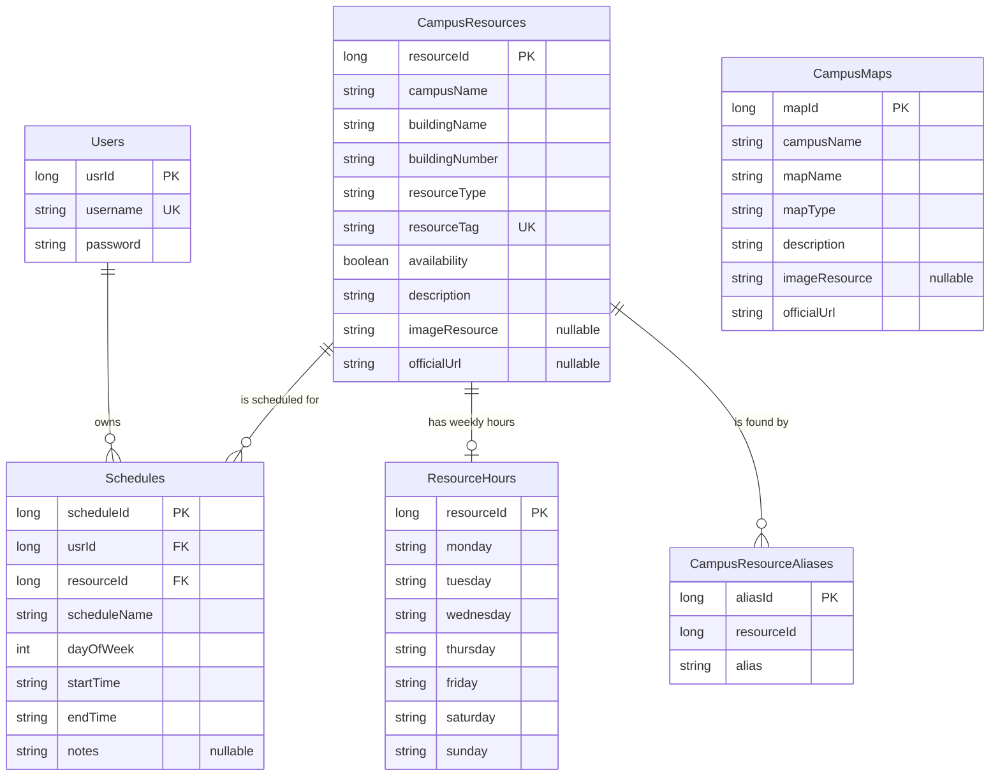

# Campus Compass database design

This document describes the Room database used by the shared module. It is meant to make the
relationships visible before a schema or query is changed. The exported Room JSON files in
[`schemas/`](../schemas/) remain the authoritative generated schema snapshots.

## Entity relationship diagram

`CampusMaps` intentionally stands apart from `CampusResources`: a campus map describes the
whole campus, while a resource describes one building, service, or facility. The UI only queries
maps after the user selects the Maps resource type and a campus.

## Table responsibilities

| Table | Responsibility | Important rules |
| --- | --- | --- |
| `Users` | Local login and schedule ownership | `username` is unique. Passwords are test credentials and must be hashed before production authentication. |
| `CampusResources` | Formal building/service catalog | `resourceTag` is the stable seed identity; `campusName` is required for campus isolation and indexed for campus-scoped queries. |
| `CampusResourceAliases` | Alternate public names used during search | One resource can have many aliases. `(resourceId, alias)` is unique. Formal names remain in `CampusResources`. |
| `ResourceHours` | Weekly hours for one resource | One row per resource; deleting a resource cascades its hours. |
| `Schedules` | A user’s planned visit to a resource | References both `Users` and `CampusResources`; both relationships cascade on deletion. |
| `CampusMaps` | Campus-wide visual map metadata and local image references | `(campusName, mapType)` is unique; `imageResource` is nullable when no local image is available. |

## Search behavior

Resource search matches, in order of meaning rather than priority:

1. Formal building name
2. Official building number or label
3. Verified alternate alias

The campus filter is applied to the resource row before an alias match can be returned. This is
important because labels such as `Library`, `Student Center`, and `Building 10` can be reused by
different institutions.

Aliases are seeded only when supported by a campus map or official public campus material. An
alias should not be added because it merely sounds plausible; if a name is uncertain, the formal
building name remains searchable and the alias is left out.

## Migration history

- Version 4 → 5: added the unique username index.
- Version 5 → 6: added resource descriptions, optional local images, and optional official URLs.
- Version 6 → 7: added campus-wide map records.
- Version 7 → 8: added normalized resource aliases and indexes for alias lookup.
- Version 8 → 9: added an index on `CampusResources.campusName` for fast campus-scoped searches.

When changing an entity, update the entity definition, `CampusMigrations`, tests, and the exported
schema snapshot together. Room’s migration guidance is available at
<https://developer.android.com/training/data-storage/room/migrating-db-versions>.
